<!-- STARK-GRADE PROFILE README · Jesús Franco -->

<div align="center">


<a href="https://git.io/typing-svg">
  
</a>

<br/>


</div>


## ⚡ `> boot_sequence.exe`

```text
╔════════════════════════════════════════════════════════════════╗
║  JESÚS-OS v19.0  ·  PERSONAL PROFILE INTERFACE                 ║
╠════════════════════════════════════════════════════════════════╣
║  OPERATOR ........ Jesús Franco                                ║
║  AGE ............. 19                                          ║
║  ORIGIN .......... Colombia                                    ║
║  MAJOR ........... Systems Engineering                         ║
║  CORE DIRECTIVE .. Turn ideas into real-world solutions        ║
║  ENERGY SOURCE ... Curiosity · Discipline · Music · Football   ║
║  STATUS .......... ██████████████████░░  Upgrading...          ║
╚════════════════════════════════════════════════════════════════╝
```

## 📊 `> current_status`

```yaml
name: Jesús Franco
age: 19
country: Colombia
education: Systems Engineering Student
language: Spanish (Native)
english: Learning and improving every day
current_focus:
  - Software Engineering
  - System Design
  - Artificial Intelligence
  - Data Technologies
status: Building the future...
```


## 🧠 `> whoami`

I'm a **19-year-old Systems Engineering student from Colombia** who believes technology is a tool to **create opportunities, solve real problems and improve lives**.

Disciplined, proactive and endlessly curious — I treat every project, challenge and line of code as a chance to grow.

> *"Technology is more than code."*

## 🧭 `> philosophy_protocol`

**Technology without purpose is just code.**

I believe in:

- 📚 Continuous learning
- 🔥 Discipline over motivation
- 🔭 Long-term thinking
- 🛠️ Building solutions that matter
- 🌍 Using technology to create opportunities


## 🔬 `> active_research_labs`

<div align="center">

| 🧪 LAB | 🎯 FOCUS |
|:--|:--|
| 💻 **Software Development** | Clean, maintainable and reliable code |
| 🏗️ **Software Architecture** | Designing systems that scale |
| 🗄️ **Databases** | Modeling, querying and optimizing data |
| 🤖 **Artificial Intelligence** | Understanding and applying intelligent systems |
| 🛡️ **Cybersecurity Fundamentals** | Building with security in mind |
| ☁️ **Cloud Technologies** | Modern, distributed infrastructure |
| 🧩 **Problem Solving** | Algorithms, logic and critical thinking |
| 🌐 **English Learning** | Global communication, level-up in progress |

</div>

## 🛠️ `> tech_arsenal`

<div align="center">

**Languages**<br/>


**Databases**<br/>


**Tools & Platforms**<br/>


</div>


## 📡 `> live_telemetry`

<div align="center">


<br/>


</div>

## 🎵 `> human_module`

When I'm not coding, you'll probably find me:

- ⚽ Watching or playing football
- 🎧 Listening to music
- 📚 Learning something new
- ☕ Thinking about the next project


## 🎯 `> mission_objectives`

- [x] Lay down a solid technical foundation
- [ ] Grow as a Systems Engineer, one project at a time
- [ ] Build impactful software projects
- [ ] Reach a professional level of English
- [ ] Master new technologies and methodologies
- [ ] Contribute to meaningful solutions through technology

## 🚀 `> roadmap`

```text
2026  ██████████░░░░░░  Learning & Building
2027  ███████░░░░░░░░░  Advanced Engineering
2028  █████░░░░░░░░░░░  Professional Growth
2030  ███░░░░░░░░░░░░░  Global Impact
```

## 🧬 `> core_algorithm`

```java
public class JesusFranco {

    public static void main(String[] args) {

        while (alive) {
            learn();
            build();
            improve();
            repeat();
        }
    }
}
```


## 🤖 `> ai_assessment`

<div align="center">



</div>

## 🌎 `> vision`

<div align="center">

> **Technology is more than code.**
> It is a tool capable of creating opportunities, solving real-world problems and improving people's lives.
>
> My goal: become an engineer who **designs innovative solutions**, **builds reliable systems** and **contributes positively through technology**.

</div>


## 📬 `> establish_connection`

<div align="center">

<a href="https://github.com/jesusitoow"></a>
<a href="https://www.instagram.com/jesusitoow/"></a>
<a href="https://www.tiktok.com/@jesusitoow_"></a>
<a href="https://linktr.ee/jesusitoow"></a>
<a href="mailto:Jesusdfranco@pronton.me"></a>

<br/><br/>


<br/><br/>

⚡ **Dream. Learn. Build. Repeat.** ⚡


</div>